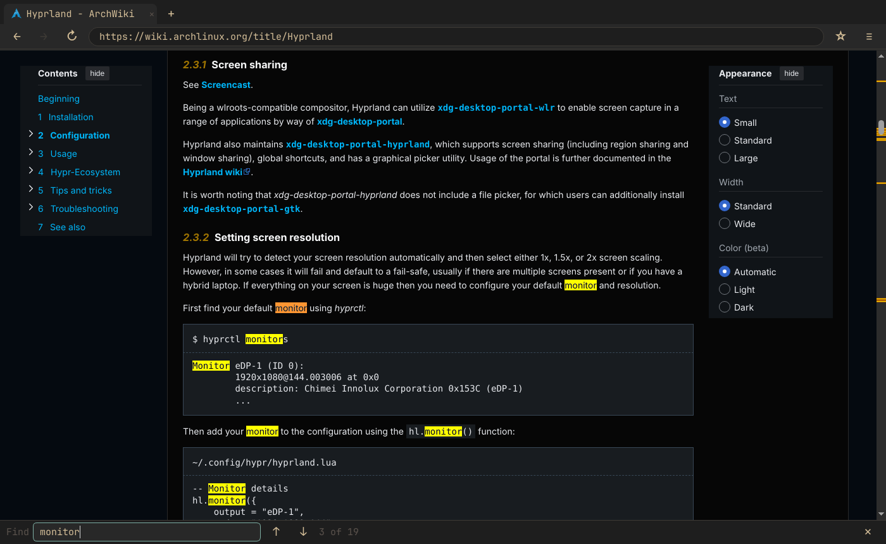
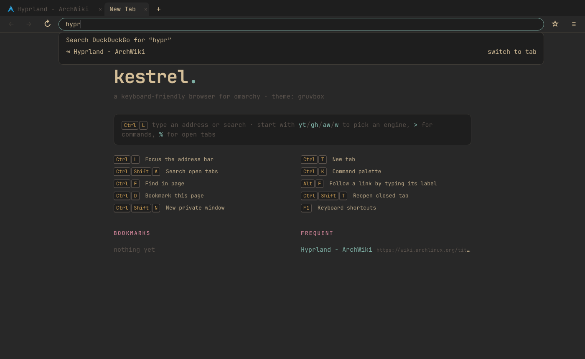
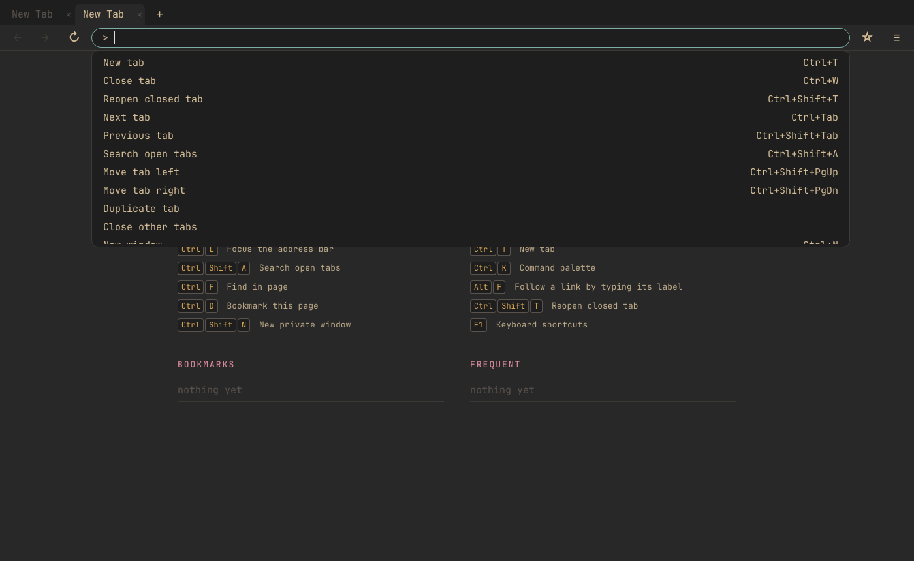
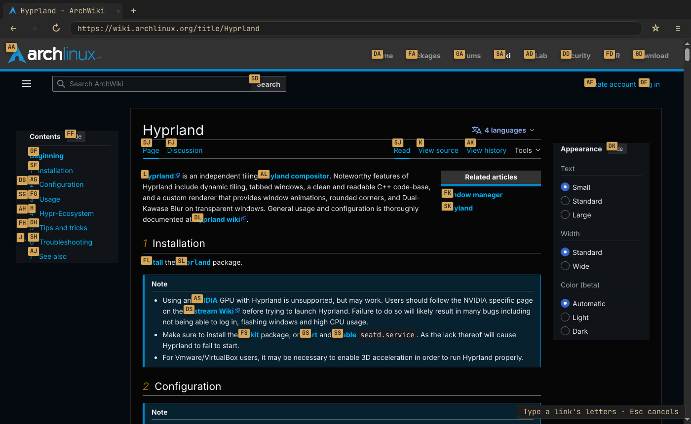
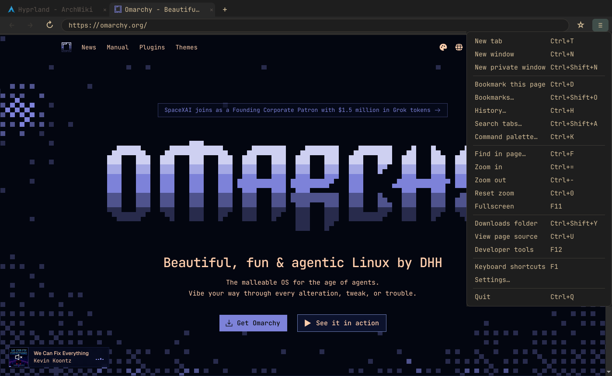

# Kestrel

A web browser for [Omarchy](https://omarchy.org) that works like a normal browser, with a keyboard shortcut for nearly everything. It has tabs, an address bar, back/forward buttons and a menu, follows your Omarchy theme, and runs on Chromium (Qt WebEngine), so sites work as they do in Chrome.



| Address bar suggestions | Command palette (`Ctrl+K`) |
|---|---|
|  |  |
| **Link hints (`Alt+F`)** | **Menu** |
|  |  |

## Features

- **Works like a normal browser.** Typing goes to the page. Keyboard shortcuts are `Ctrl`/`Alt` chords and F-keys, so they never get in the way of typing, and they work even while a text field is focused.
- **Address bar that does more.** It suggests from your bookmarks, history and open tabs. A few prefixes change what it searches:
  - `yt lofi`, `aw pacman`, `gh hyprland`: search YouTube, the Arch Wiki or GitHub
  - `>`: run a command
  - `%`: jump to an open tab
  - `*`: search bookmarks
  - `^`: search history
- **Command palette (`Ctrl+K`).** Lists every action with its shortcut, so you can look things up as you go.
- **Link hints (`Alt+F`).** Labels every link on the page; type a label to click it. `Alt+Shift+F` opens the link in a background tab instead.
- **Follows the Omarchy theme.** Colors are read from `~/.config/omarchy/current/theme` and update within about 2 seconds of a theme change. Sites that support dark mode switch to match.
- **Tabs and windows.**
  - Session restore. Background tabs only load when you open them.
  - Reopen closed tabs.
  - Middle-click a tab to close it.
  - Multiple windows.
  - Private windows.
- **Built in:** find bar, bookmarks, downloads to `~/Downloads` with a notification, site permission prompts, fullscreen video, devtools.
- **Single instance.** Running `kestrel URL` while Kestrel is open adds a tab to the open window, so it works as your default browser.
- **Optional Vim mode.** Set `keymap = "vim"` to add modal keys on top of the normal shortcuts: `j`/`k` scrolling, `f` hints, `o` to open, `:` for the palette.

## Install (Omarchy / Arch)

```bash
git clone https://github.com/DaCoder1/Browser.git kestrel && cd kestrel
./install.sh            # installs deps via pacman, puts `kestrel` in ~/.local/bin
./install.sh --default  # optional: also make it the default browser (Super+Shift+B)
```

Or build a real package with `makepkg -si` (uses the included `PKGBUILD`).

## Shortcuts

Press `F1` in the browser for the full list, or `Ctrl+K` and type what you want.

| Tabs & windows | |
|---|---|
| New tab / close tab | `Ctrl+T` / `Ctrl+W` |
| Reopen closed tab | `Ctrl+Shift+T` |
| Next / previous tab | `Ctrl+Tab` / `Ctrl+Shift+Tab` (or `Ctrl+PgDn` / `PgUp`) |
| Jump to tab 1–8 / last tab | `Ctrl+1…8` / `Ctrl+9` (also `Alt+1…9`) |
| Search open tabs | `Ctrl+Shift+A` |
| Move tab left / right | `Ctrl+Shift+PgUp` / `PgDn` |
| New window / private window | `Ctrl+N` / `Ctrl+Shift+N` |
| Close window / quit | `Ctrl+Shift+W` / `Ctrl+Q` |

| Navigation & address bar | |
|---|---|
| Back / forward | `Alt+←` / `Alt+→` |
| Reload / hard reload | `Ctrl+R` or `F5` / `Ctrl+Shift+R` |
| Focus address bar | `Ctrl+L`, `Alt+D`, `F6` |
| Command palette | `Ctrl+K` |
| Bookmarks / history | `Ctrl+Shift+O` / `Ctrl+H` |
| Open in a new tab from the address bar | `Alt+Enter` |

| Page | |
|---|---|
| Find / next / previous | `Ctrl+F` / `F3` or `Ctrl+G` / `Shift+F3` |
| Bookmark page | `Ctrl+D` |
| Follow link / in background tab / copy link | `Alt+F` / `Alt+Shift+F` / `Alt+Y` |
| Focus first text field | `Alt+I` |
| Copy page URL | `Alt+C` |
| Zoom in / out / reset | `Ctrl+=` / `Ctrl+-` / `Ctrl+0` |
| Fullscreen | `F11` |
| View source / devtools | `Ctrl+U` / `F12` |
| Downloads folder | `Ctrl+Shift+Y` |

## Configuration

Open the settings from the menu (**Settings…**) or edit `~/.config/kestrel/config.toml` (see `config.example.toml`). In that file you can:

- switch to the Vim keymap
- change the search engine
- add search shortcuts
- remap any shortcut (`"<C-e>" = "tab-search"`), or unbind one with `"nop"`

Data lives in `~/.local/share/kestrel/` (history and bookmarks in SQLite, plus `session.json`).

## Development

```bash
pip install PyQt6 PyQt6-WebEngine pytest
python -m kestrel          # run from the repo
python -m pytest tests     # unit tests
```

Code layout:

| File | What it holds |
|---|---|
| `kestrel/app.py` | app controller: windows, sessions, theme, single instance |
| `kestrel/window.py` | browser window, shortcuts, commands |
| `kestrel/widgets.py` | address bar, suggestions, find bar |
| `kestrel/commands.py` | list of every command |
| `kestrel/config.py` | default key bindings and settings |
| `kestrel/js/kestrel.js` | link hints and scrolling, injected into an isolated JS world |
