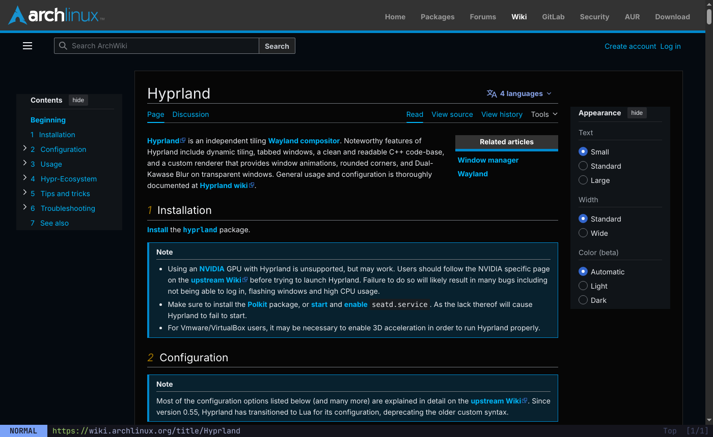
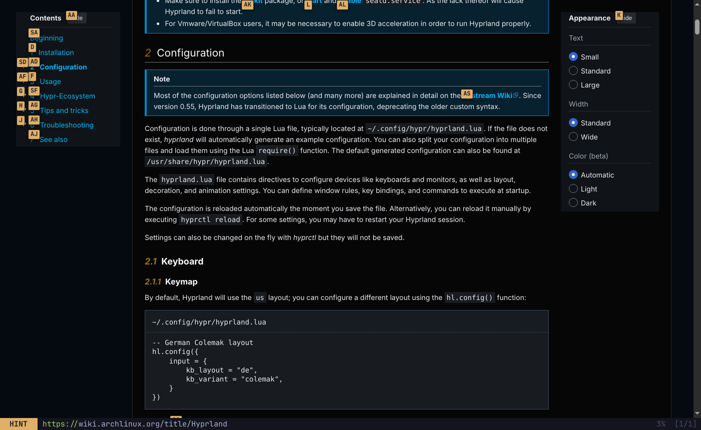
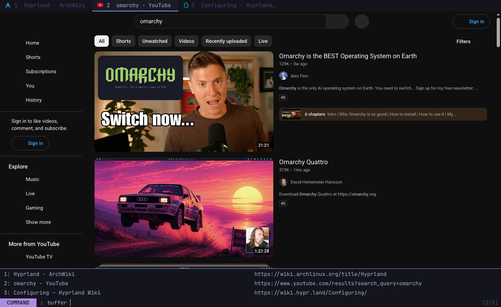
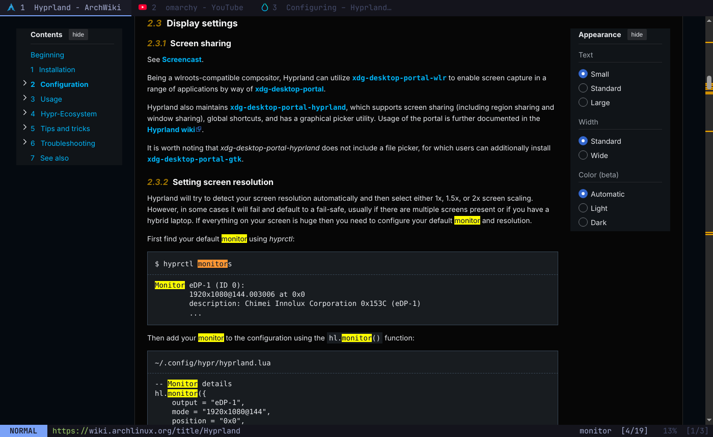
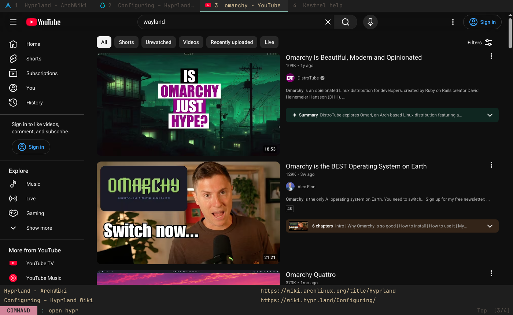

# Kestrel

A keyboard-driven web browser for [Omarchy](https://omarchy.org). It uses Vim-style keys, follows your Omarchy theme, and runs on Chromium (Qt WebEngine), so sites work as they do in Chrome.



| Link hints (`f`) | Tab picker (`b`) |
|---|---|
|  |  |
| **Find in page (`/`)** | **Live theme switch + history completion (`o`)** |
|  |  |

## Features

- **Modal Vim keys.** NORMAL mode for commands, INSERT for typing into the page, HINT for following links, COMMAND for the `:` line, and PASSTHROUGH to send every key to the page.
- **Link hints.** `f` follows a link, `F` opens it in a background tab, `yf` copies its URL.
- **Follows the Omarchy theme.** Colors come from `~/.config/omarchy/current/theme` (`colors.toml` or `alacritty.toml`). When you change theme with `omarchy-theme-set` or the menu, Kestrel updates within about 2 seconds. Sites that support dark mode pick up your theme's dark or light setting.
- **Command line with completion.** `o`, `O` and `t` complete from your bookmarks and history. Search shortcuts work there too: `yt lofi`, `aw pacman`, `gh hyprland`, `w kestrel`.
- **Tabs.** `J`/`K` switch tabs, `Alt+1…9` jumps to a tab, `x` closes one, `X` reopens it, and `b` opens a fuzzy tab picker.
- **Session restore.** Kestrel reopens your tabs on start. Background tabs only load when you open them.
- **Persistent profile.** Logins, cookies and history are kept between runs. Run `--private` for a throwaway window.
- **Single instance.** Running `kestrel URL` while Kestrel is open adds a tab to the open window, so it works as your default browser.
- **Built in:** downloads to `~/Downloads` with a `notify-send` toast, site permission prompts (`y`/`n`), fullscreen video, and devtools (`F12`).
- **Wayland native.** The app id is `kestrel`, so you can write Hyprland window rules for it.

## Install (Omarchy / Arch)

```bash
git clone https://github.com/DaCoder1/Browser.git kestrel && cd kestrel
./install.sh            # installs deps via pacman, puts `kestrel` in ~/.local/bin
./install.sh --default  # optional: also make it the default browser (Super+Shift+B)
```

Or build a real package with `makepkg -si` (uses the included `PKGBUILD`).

To open it with its own key, add a line like this to `~/.config/hypr/bindings.conf` (use any free key):

```
bindd = SUPER SHIFT, K, Kestrel, exec, uwsm app -- kestrel
```

## Keys

Press `?` in the browser for the full list. Most keys take a count, e.g. `5j` or `3x`.

| Keys | Action |
|---|---|
| `j` `k` `h` `l` | scroll |
| `d` `u` / `Space` `Shift+Space` | half page / full page |
| `gg` `G` | top / bottom (`50G` = 50%) |
| `H` `L` | back / forward |
| `r` `R` | reload / hard reload |
| `o` `O` `t` | open URL or search (here / new tab) |
| `go` `gO` | edit current URL |
| `p` `P` | open clipboard (here / new tab) |
| `f` `F` `yf` | hint: follow / background tab / copy URL |
| `J` `K`, `gt` `gT` | next / previous tab |
| `Alt+1…9`, `g0` `g$` | jump to tab, first / last tab |
| `x` `X` `yd` | close / reopen / duplicate tab |
| `Alt+,` `Alt+.` | move tab left / right |
| `b` | pick a tab by name |
| `/` `n` `N` | find, next, previous |
| `i` `gi` | insert mode / focus first input |
| `Esc` | back to normal mode; clears hints and search |
| `Ctrl+v` | passthrough mode (`Shift+Esc` leaves) |
| `yy` `yt` | copy URL / title |
| `zi` `zo` `zz` (`+` `-` `=`) | zoom in / out / reset |
| `B` | toggle bookmark |
| `gu` `gU` | up one URL level / site root |
| `:` | command line (`:help`, `:private`, `:tab-only`, `:quit`…) |
| `F12` | devtools |
| `ZZ` `ZQ` | quit (with / without saving the session) |

Clicking into a text field switches to INSERT mode, and clicking elsewhere switches back. A site that focuses its own search box won't take your keys.

## Configuration

Copy `config.example.toml` to `~/.config/kestrel/config.toml`. In that file you can:

- change the search engine
- add search shortcuts
- change hint letters, scroll step, zoom and font
- remap any key (`"<C-t>" = "set-cmd open -t "`, or `"x" = "nop"` to unbind it)

Data lives in `~/.local/share/kestrel/` (history and bookmarks in SQLite, plus `session.json`).

## Development

```bash
pip install PyQt6 PyQt6-WebEngine pytest
python -m kestrel          # run from the repo
python -m pytest tests     # unit tests
```

Layout: `kestrel/app.py` (window, modes, commands), `kestrel/js/kestrel.js` (hints, scrolling and focus detection, injected into an isolated JS world), `kestrel/theme.py`, `kestrel/config.py`, `kestrel/storage.py`, `kestrel/pages.py`.
